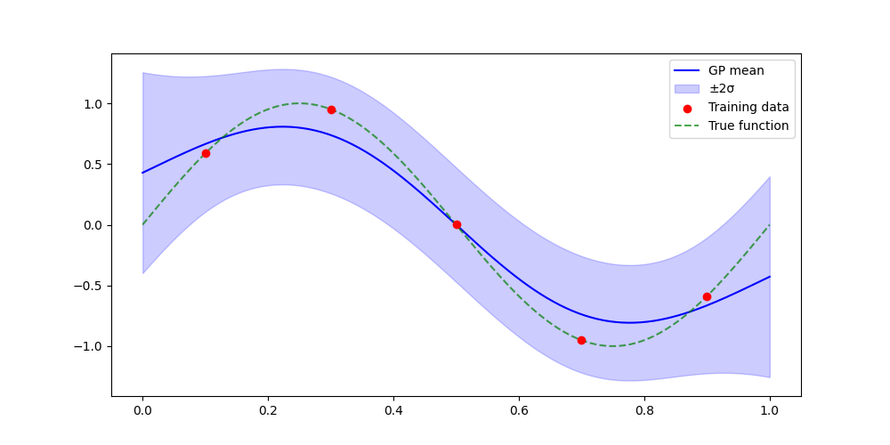

# Algorithm Testing

Gaussian process regression and Bayesian optimization, written from scratch in
C++ with no linear algebra library. I wrote it to learn how the pieces fit
together.



## What is here

**Gaussian process** (`GP_impl.cpp`)
- Squared-exponential kernel with a noise term on the diagonal.
- `fit()` factors the kernel matrix with a hand-written Cholesky decomposition
  and solves for the weights by forward and backward substitution.
- `predict()` returns the posterior mean and variance at a point.

**Bayesian optimization** (`BO_impl.cpp`)
- Expected improvement as the acquisition function, evaluated over a grid of
  300 candidates.
- Starts from 5 random samples, then runs 50 rounds of: fit the GP, pick the
  candidate with the highest expected improvement, evaluate the objective
  there, add the point.
- The objective is `sin(0.2πx) + 7cos(x) + 3` on `[-20, 20]`, which has plenty
  of local maxima to get stuck on.

`results/` has GP fits to `sin(2πx)` at a few different length scales, drawn by
`plot.py`.

## Run

```sh
g++ -std=c++17 -O2 main.cpp GP_impl.cpp BO_impl.cpp -o main
./main
```

It prints the point chosen at each iteration and the best value so far:

```
Iteration 48: x = -18.5284, f(x) = 10.4405, f_best = 10.9882
Iteration 49: x = -19.1973, f(x) = 10.0642, f_best = 10.9882
Iteration 50: x = -3.67893, f(x) = -3.75149, f_best = 10.9882
```
